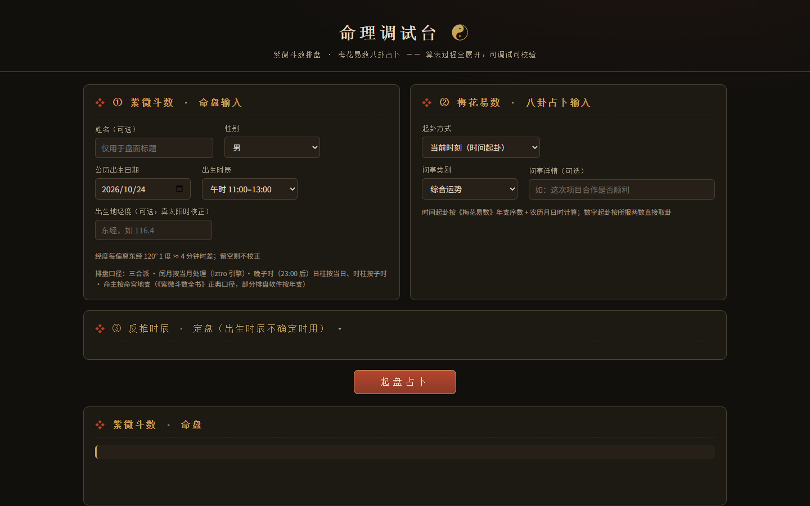

  

  # 命理调试台 · mingli-lab

  紫微斗数排盘 + 梅花易数占卜的纯前端调试工具——完整展示每一步算法过程，可校验、可学习。

> 🤖 **AI 作品声明**：本项目由 supermaga 策划与验收、AI 智能体协作编码——人机共创，代码与视觉均为原创产出，非人类手写、无第三方素材。

## 亮点

- **紫微斗数** —— 三合派口径，真太阳时经度校正、闰月按月处理（iztro 引擎）、晚子时规则，命主按乾坤地支（《紫微斗数全书》正典口径）
- **梅花易数** —— 时间起卦（年支序数 + 农历月日计卦）与数字起卦双入口，问事类别 / 详情可选
- **反推时辰定盘** —— 出生时辰不确定时，按已知信息反推校验
- **零依赖** —— 纯前端双击即用，深色界面

## 状态

可用（v1.1 高保真验证版）。

> 源码暂未公开，本仓库为项目名片。

---

<small>© 2026 supermaga.top · 保留所有权利</small>
